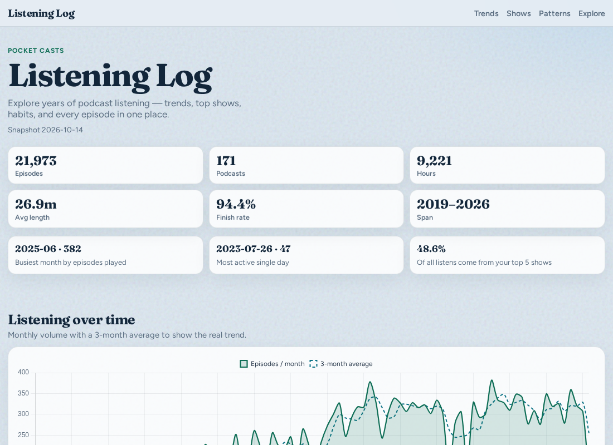
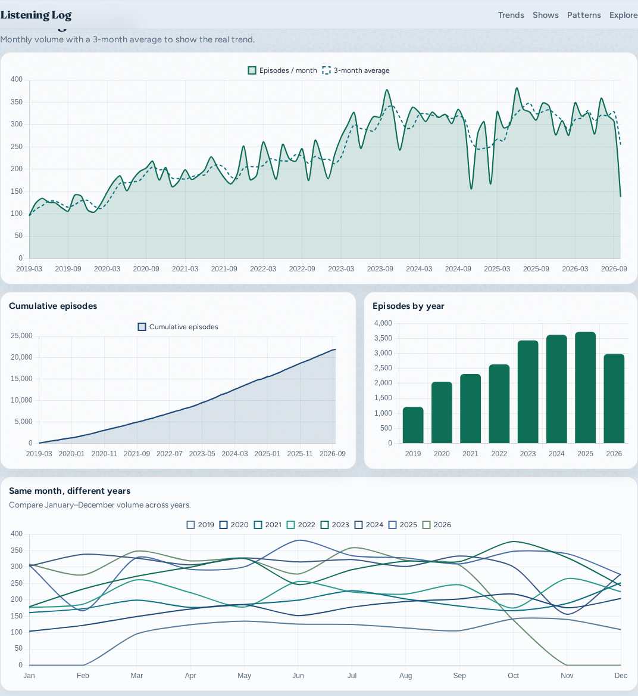
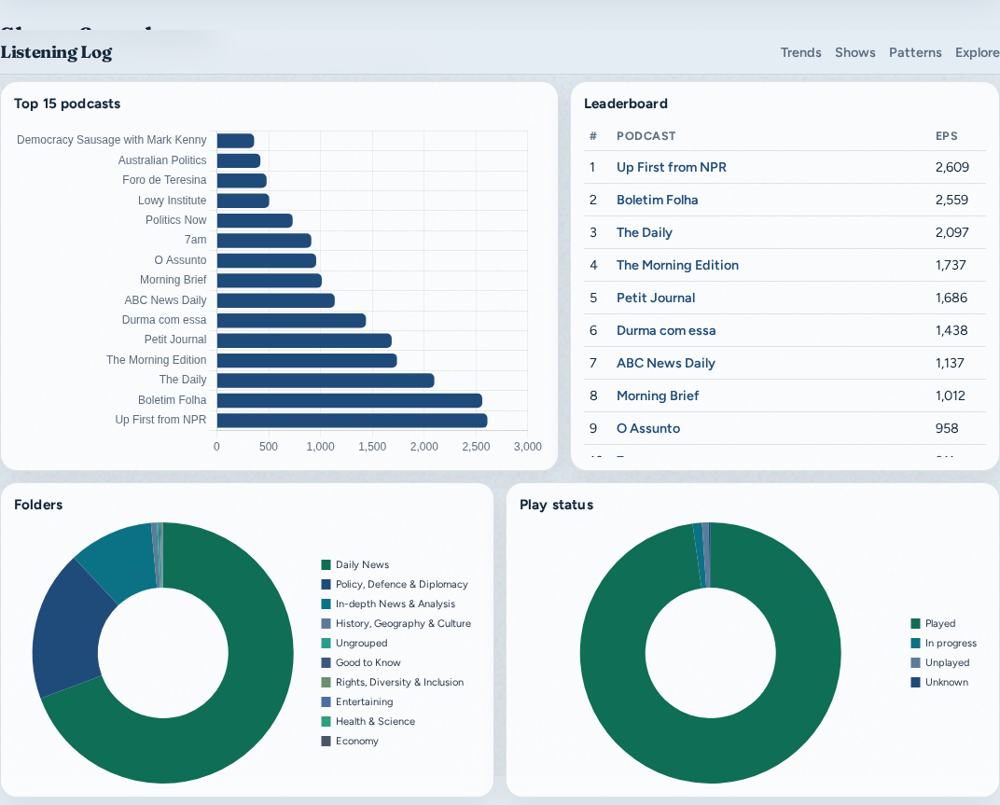

# Pocket Casts listening history

Personal Pocket Casts listening history + **Listening Log** explorer.

Everything lives in this GitHub repository. No third-party hosts or CDNs.

## Live site

**https://wlad-c.github.io/rss-feeds/**

## Interactive explorer (offline)

Download the single-file app from this repo, then open it on your phone/iPad/laptop:

**[`listening-log-standalone.html`](./listening-log-standalone.html)**

It includes the full history, charts, filters, year-over-year comparison, and a listening calendar. It makes **no network requests**.

There is also a multi-file version (`index.html` + `explore.js` + `tables/`) for local HTTP preview:

```bash
cd pocketcasts-history
python3 -m http.server 8765
```

## Chart snapshots (view on GitHub)








## Tables

- [Episodes CSV](./tables/episodes.csv)
- [Podcasts CSV](./tables/podcasts.csv)
- [Recent 500 CSV](./tables/recent.csv)
- [Excel workbook](./PocketCasts_Listening_History.xlsx)
- [Aggregates JSON](./tables/aggregates.json)
- [History coverage](./tables/coverage.json) — account stats + years probed (2010–2018 empty)
- [Played without timestamp](./tables/played_without_listen_timestamp.json) — marked-played episodes with no listen date

Per-episode Listening History from Pocket Casts begins **2019-03-07**. Account stats start **2015-09-11**, but `/history/year` returns **0** rows for 2010–2018 (history was never cleared).

## Rebuild standalone file

```bash
python3 build-standalone.py
```
