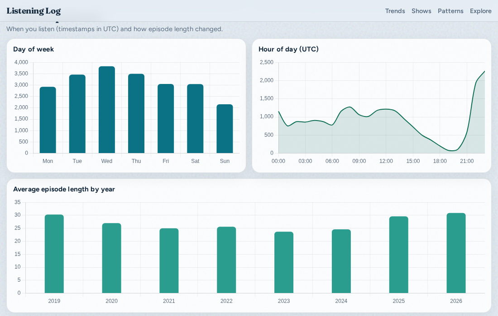
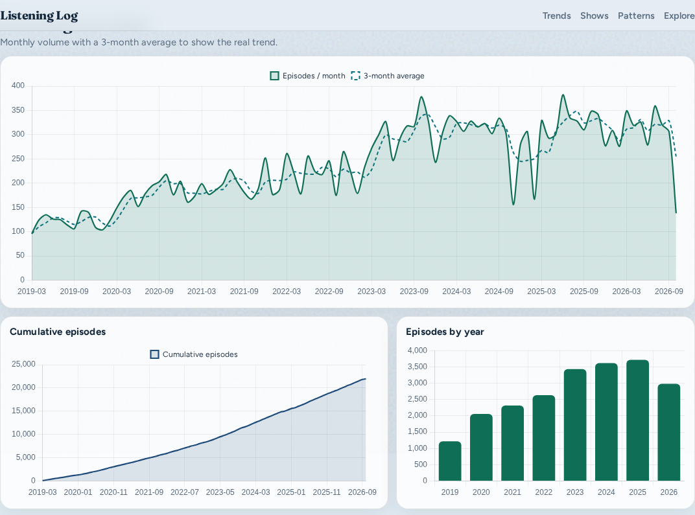
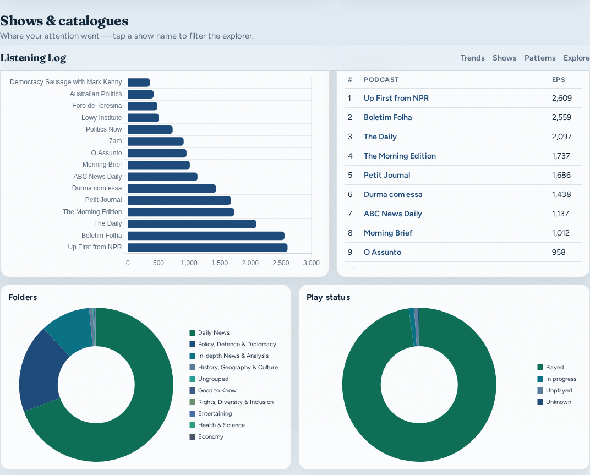
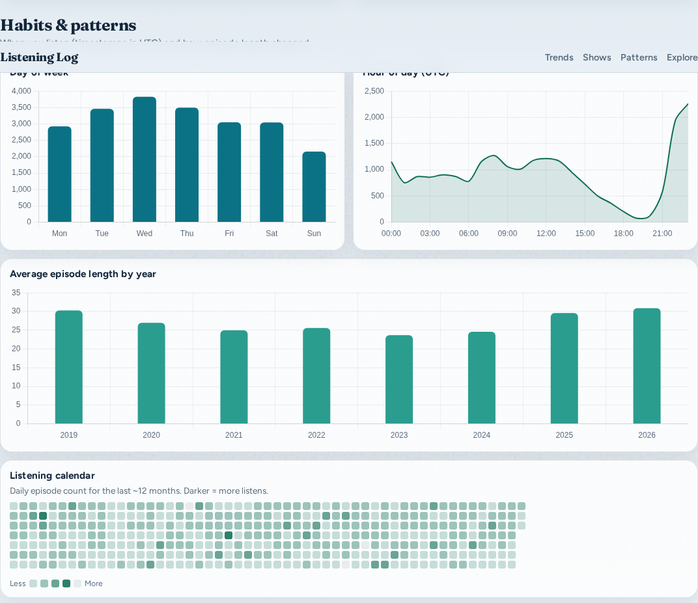

# Pocket Casts listening history

Personal Pocket Casts listening history + **Listening Log** explorer.

Everything lives in this GitHub repository. No third-party hosts or CDNs.

> **Agent ship gate:** before merging UI/CSS/filter changes, follow the
> [golden rule in `/AGENTS.md`](../AGENTS.md#golden-rule-never-ship-listening-log-ui-with-edge-cutoffs)
> and run `node scripts/check_mobile_edges.mjs` against a local server — must pass.

## Live site

**Prefer GitHub Pages (source of truth):** **https://wlad-c.github.io/rss-feeds/**

After a UI deploy, confirm the footer shows the current `build …` stamp. If edges still look clipped, tap **Refresh** (clears caches) or open the Pages URL in a Private Tab — do **not** trust a stale jsDelivr tab.

CDN mirror (can lag hours despite purge): **https://cdn.jsdelivr.net/gh/wlad-c/rss-feeds@gh-pages/pocketcasts-history/**

## Interactive explorer (offline)

Download the single-file app from this repo, then open it on your phone/iPad/laptop:

**[`listening-log-standalone.html`](./listening-log-standalone.html)**

It includes the full history, charts, theme suggestions, topic search, filters, year-over-year comparison, and a listening calendar. It makes **no network requests**.

There is also a multi-file version (`index.html` + `explore.js` + `tables/`) for local HTTP preview:

```bash
cd pocketcasts-history
python3 -m http.server 8765
```

## Chart snapshots (view on GitHub)









## Tables

- [Episodes CSV](./tables/episodes.csv)
- [Podcasts CSV](./tables/podcasts.csv)
- [Recent 500 CSV](./tables/recent.csv)
- [Excel workbook](./PocketCasts_Listening_History.xlsx)
- [Aggregates JSON](./tables/aggregates.json)
- [Themes JSON](./tables/themes.json) — suggested topics across listened episodes
- [Notes / transcripts JSON](./tables/notes.json) — RSS show notes + published transcripts where available
- [History coverage](./tables/coverage.json) — account stats + years probed (2010–2018 empty)
- [Played without timestamp](./tables/played_without_listen_timestamp.json) — marked-played episodes with no listen date

Per-episode Listening History from Pocket Casts begins **2019-03-07**. Account stats start **2015-09-11**, but `/history/year` returns **0** rows for 2010–2018 (history was never cleared).

## Themes & searchable notes

Episode **themes** are inferred from titles across the full history (news titles are dense topic labels). Where podcast RSS feeds publish show notes or Podcasting 2.0 `podcast:transcript` files, those texts are stored for search too.

**Full transcripts** live in `transcripts/full.sqlite` (not shipped to GitHub Pages). `tables/notes.json` keeps searchable **snippets** plus `full` / `chars` flags.

```bash
# 1) Seed store from any existing notes, then harvest publisher transcripts (full text, free)
python3 scripts/seed_store_from_notes.py
python3 scripts/harvest_full_transcripts.py

# 2) YouTube → full text (src=youtube)
#    Prefer Gemini video understanding when GEMINI_API_KEY is set (full audio
#    transcript from the YouTube URL — works for long shows without captions,
#    e.g. Xadrez Verbal). Free tier ≈8h YouTube/day. Fallbacks: caption APIs.
python3 scripts/harvest_youtube_transcripts.py --shows "Xadrez Verbal" \
  --backends gemini --max-episodes 2 --min-year 2022 --sleep 5

# 3) Optional free STT for high-value gaps (no paid API)
#    auto = NoteTakers free 10/day, then local faster-whisper
python3 scripts/selective_stt.py --engine auto --max-episodes 40 --max-minutes 480 --model base

# 4) Rebuild flat themes using full text when available
python3 scripts/rebuild_theme_hierarchy.py

# 5) Sync slim tables into docs/ for Pages
python3 scripts/sync_docs_tables.py
```

Legacy helpers (snippet-capped) still exist:

```bash
python3 scripts/build_themes_and_notes.py
python3 scripts/fetch_publisher_transcripts.py
python3 scripts/fetch_omny_transcripts.py
```


## Theme refresh (every 20 min)

When new full transcripts land in `transcripts/full.sqlite` (e.g. ongoing Gemini
harvests), themes are rebuilt with within-episode **time shares**:

```bash
# Check fingerprint; rebuild + sync docs only when the store changed
python3 scripts/refresh_themes_from_transcripts.py

# Also pull a richer store from a harvest branch first
python3 scripts/refresh_themes_from_transcripts.py \
  --adopt-remote-branch cursor/xv-gemini-transcripts-8084
```

**Schedule:** GitHub Action **Listening Log theme refresh** runs every **20 minutes**
(`:05`, `:25`, `:45` UTC) and adopts `cursor/xv-gemini-transcripts-8084` when that
branch has more transcript chars than `main`. Manual: Actions → Listening Log
theme refresh → Run workflow.

## Daily sync

Refresh listening history from Pocket Casts (needs `POCKETCAST_EMAIL` / `POCKETCAST_PASSWORD`):

```bash
python3 scripts/sync_listening_history.py
```

**Schedule (active):** a Cursor cloud-agent timer runs this around **00:05 Australia/Sydney** (AEST/AEDT) using the existing Cursor `POCKETCAST_*` secrets, then pushes to `main`.

**GitHub Action (optional mirror):** workflow **Listening Log daily sync** is also on `main` with the same midnight Sydney window + `workflow_dispatch`. It needs repo Actions secrets `POCKETCAST_EMAIL` / `POCKETCAST_PASSWORD`. The Cursor GitHub App cannot create those secrets (API 403 — requires a repo admin session).

## Rebuild standalone file

```bash
python3 build-standalone.py
```
